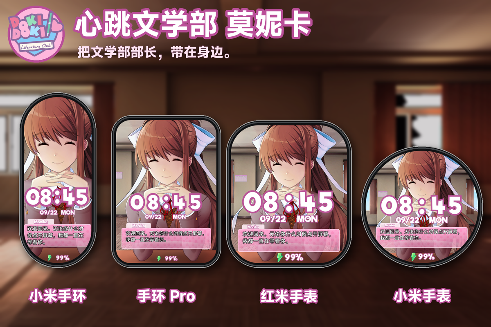
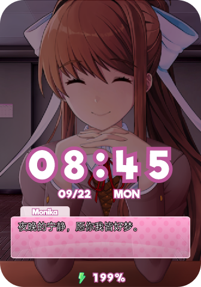

# 莫妮卡互动表盘

将《心跳文学部》的莫妮卡带到小米 / Redmi Vela 穿戴设备上陪伴你。

## 功能

- 显示时间、日期、星期和电量。
- 每隔 7～10 秒眨眼，按时间自动切换日夜素材。
- 亮屏显示分时段问候，触摸头部显示微笑与对话，点击对话框可收起。
- 文字对话按字符数停留 3～8 秒；手环 8 Pro 的图片对话逐条配置阅读时长。
- 内置多分类对话，结合步数、心率及低电量状态选择情景对话，包含概率触发的惊吓彩蛋。
- 专属纪念日与节日问候：覆盖 9.22 莫妮卡生日、情人节、520、元旦、圣诞及万圣节等，节日当天开屏专属祝福。
- 电量较低（≤20% / ≤10%）时，莫妮卡会适度触发专属的体贴充电提醒，不刷屏且有去重保护。
- 轻触屏幕底部电量区域，可开启/关闭惊吓恶作剧彩蛋，并伴有专属反馈台词（不与摸头刷对话冲突）。
- 手环 8 Pro 使用 21 条图片对话，不启用健康数据联动。
- 熄屏暂停动画定时器，亮屏恢复；仅状态或表情变化时更新界面。

## 预览

<p align="center">
  
  
  
</p>

设备目录中的 `preview.png` 根据当前静态布局自动生成并添加屏幕圆角；实际效果以设备运行结果为准。

## 设备适配

| 设备 | 构建目标 | 布局尺寸 | EasyFace DeviceType |
| --- | --- | --- | --- |
| 小米手环 9 | `band9` | 192×490 | 366 |
| 小米手环 10 | `band10` | 212×520 | 466 |
| 小米手环 11 | `band11` | 212×520 | 共用 band10 包 |
| 小米手环 8 Pro | `band8pro` | 336×480 | 11 |
| 小米手环 9 Pro | `band9pro` | 336×480 | 367 |
| 小米手环 10 Pro | `band10pro` | 336×480 | 567 |
| Redmi Watch 6 | `redmiwatch6` | 432×514 | 565 |

当前已完成工程生成与 Lua 模拟回归，统一构建后的安装兼容性和实际显示仍需真机验证。手环 11 共包方式参考倒数日表盘；手环 10 Pro 继承手环 9 Pro 的布局与素材，使用独立设备类型编译。

## 开发

生成工程需要 Python 3.9+，编译安装包参考 **EasyFace 4.23**。在仓库根目录执行：

```powershell
python -m pip install -r requirements.txt
python tools/build.py
python tools/test.py
python tools/build.py --compiler "<EasyFace目录>\Compiler.exe"
```

只生成指定设备：

```powershell
python tools/build.py --device redmiwatch6
python tools/build.py --device band9 --compiler "<EasyFace目录>\Compiler.exe" --id 979825266001 --version 2
```

生成工程位于 `build/<目标>/monika.fprj`，可通过 EasyFace 打开；成功编译的安装包位于 `dist/monika-<目标>.face`。默认表盘 ID 为 `979825266001`，发布版本为 `3`。编译脚本同步写入 Gen2 包头；`--id` / `--version` 可覆盖默认值。

`--device band11` 会生成 `band10` 工程，编译时同时输出 `monika-band10.face` 和 `monika-band11.face`。`build/`、`dist/` 均为忽略的构建产物，修改源码后重新生成。

### 项目结构

```text
assets/common/          共用 PNG 数字、星期、日期符号与电量图标
devices/                分设备素材与设计预览
devices.json            设备尺寸、字体、状态坐标、继承与包别名
images/                 README 展示图片
src/
  monika.lua            共享上下文、状态常量、资源路径和字体
  dialogue.lua          分类文案、对话选择、去重和阅读时长
  ui.lua                共用布局创建、点击行为、电量排列和增量属性更新
  runtime.lua           状态渲染、数据过滤、定时器与屏幕生命周期
  subscriptions.lua     时间、日期与健康数据订阅
tools/
  build.py              生成 EasyFace 工程与可选编译
  config.py             设备配置继承与包别名解析
  clean_assets.py       清理已有 PNG 替代的 BIN
  previews.py           根据设备坐标生成白天静态预览及屏幕圆角
  test.py               Lua 5.4 模拟回归与生成工程资源检查
requirements.txt        回归使用的 Python 依赖
```

构建时将共用源码和设备配置合成为单个 Lua 入口，无需设备侧模块加载。`devices.json` 的 `layout` 保存各元素位置、描边文字尺寸和不同位数电量排列，`src/ui.lua` 统一创建控件和绑定点击行为。背景、表情、文字、位置及可见状态分别缓存，只有变化的属性才写入控件。

### 素材

- 共用 PNG 位于 `assets/common/`。
- RW6 专用 PNG 直接位于 `devices/redmiwatch6/`，包含人物背景、表情、对话框和大尺寸数字。
- 手环 9、10、8 Pro、9 Pro 的背景、表情和对话框均已导入 PNG 原图；手环 11、10 Pro 复用对应配置。仅手环 8 Pro 的图片文字仍使用 BIN，位于 `devices/band8pro/text/`。
- 选择优先级为设备专用 PNG → 共用 PNG → 设备 BIN。构建自动映射动态资源路径，只打包实际选用的文件，PNG 在 EasyFace 编译阶段转换。
- 补充 PNG 后，可执行 `python tools/clean_assets.py` 清除被替代的 BIN，再重新构建。

素材与布局来自原 `band9`、`band10`、`band8pro`、`band9pro` 分支及作者提供的 RW6 工程与 PNG 导出，已完整导入仓库，构建不依赖外部素材路径或旧分支。

### 修改与验证

修改对话内容和选择规则：`src/dialogue.lua`；修改状态调度：`src/runtime.lua`；修改共用 UI 行为：`src/ui.lua`；调整设备布局：`devices.json`。对话按 `morning/afternoon/night/daily/steps/heart/easterEgg` 分类，运行时直接保存对话对象；8 Pro 的 `imageDialogues` 按分类显式配置每张图片的路径和阅读时长，不再依赖全局编号区间。

`python tools/test.py` 使用 Lua 5.4 验证全部七款配置，包括资源完整性、数据边界、电量显示、点击对话、彩蛋恢复、亮熄屏定时器和已生成工程的尺寸、素材。构建使用 Pillow 将设计预览调整为编译器要求的设备尺寸，模拟测试使用 Lupa；依赖统一列在 `requirements.txt` 中。

完整文字模式沿用旧版彩蛋选择规则：步数达到 500 且未选中健康对话后，才进行千分之一抽取，因此整体触发概率低于 0.1%。图片文字模式在普通点击对话时进行千分之一抽取。

真机检查重点为中文字体、人物眼部贴图对齐、对话换行、触摸事件、长按切换表盘与亮熄屏恢复。

动画使用单一定时器按下一事件期限动态调度，持续亮屏每 60 秒维护日夜主题，点击和心率变化主动刷新；熄屏暂停。计时不依赖部分固件缺失的 `lvgl.tick_get()`，定时回调按计划间隔累计，外部事件通过秒级 `os.time()` 同步部分已过去时间。固件繁忙或秒级精度可能令时长略有偏差。用户真机试用暂未发现调度问题；实际功耗收益尚未量化，其他设备兼容性仍需分别验证。

## 静态布局预览

运行 `python tools/previews.py` 更新全部目标，或使用 `--device band10` 指定目标。直接替换 `devices/<素材目标>/preview.png`，共用素材的目标也共用预览。构建工程时同样更新白天预览，并按 `previewSize` 生成 `build/<目标>/preview.png` 编译缩略图。

示例数据固定为 08:45、09/22 MON、99% 电量，按设备原生尺寸及实际坐标合成，仅生成白天正常状态，不含对话或表情叠图。手环 9/10/11 使用胶囊蒙版，Pro 使用 48px 圆角，RW6 使用 104px 圆角，均为抗锯齿透明边角。这是布局参考而非真机截图；圆角参数统一由 `devices.json` 的 `previewShape` 管理。band9 沿用原布局，时间数字左右边缘略有裁切。

## 相关链接

- [EasyFace](https://github.com/m0tral/EasyFace)
- [米坛社区](https://www.bandbbs.cn/resources/2357/)
- [参考项目：倒数日表盘](https://github.com/sf-yuzifu/daymatter-ng-watchface)

## 许可证

本项目使用 [GPL v3](LICENSE)，并附有[中文补充条款](附加条款.md)。
